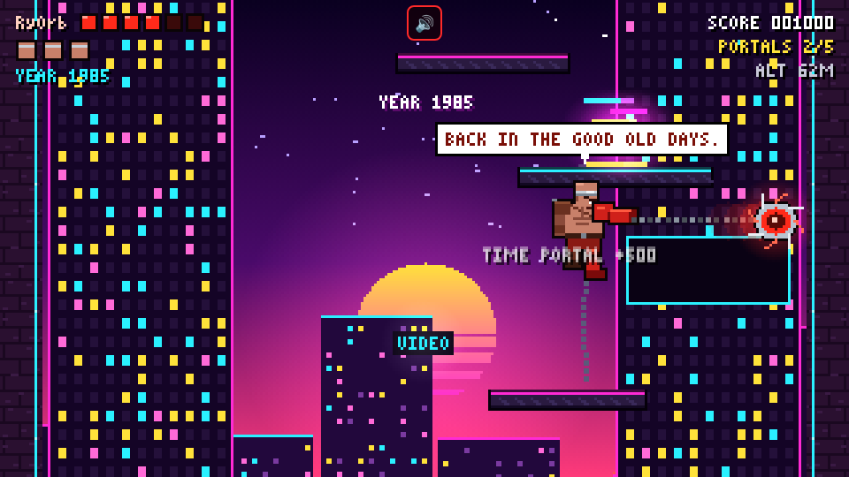
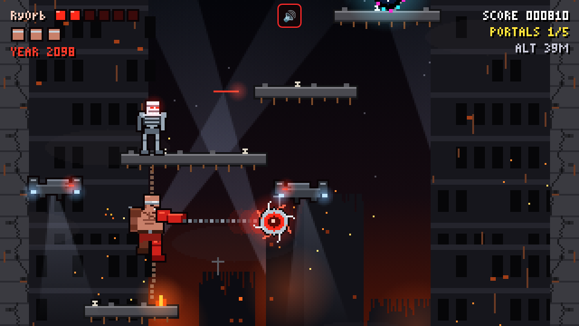

# RyOrb: Rift of Ages (1985 // 2098)

A Rygar-style vertical climbing action game in a single self-contained HTML file (canvas, procedural pixel art, WebAudio SFX, no dependencies).

**Play:** https://unaimedplayer2025-afk.github.io/ryorb-rift-of-ages/ · **Attract mode:** add `?demo`

RyOrb, a scarred cyborg warrior with a red mechanical arm and leg, climbs a tower that tears between a neon synthwave 1985 arcade city and a ruined, burning machine war zone in 2098. Hunt the 5 time portals with your spinning spiked disc-shield on a chain, and destroy the OMEGA SENTINEL at the summit.

## Enemies (era-specific)

 

- **1985** (neon rim-lit, synthwave): **Neon Punks** (mohawks, studded leather, shoulder spikes; brawl and lob bottles, some swing boomboxes), **Vice Mercs** (mullets, pastel suits with rolled sleeves, shades; pop out from behind crates with pistols or SMG bursts), **VHS Ninjas** (fast, front-flip, dash-slash, throw shuriken).
- **2098** (machines only): **Hunter Drones** (flying gunships with searchlights) and **Sentinel Units** (chrome endoskeletons with red eyes).
- Enemies from the other era are ripped out of the timeline when you warp. Types live in one `ENEMY_TYPES` registry, with `ERA_ROSTER` listing which appear in each era.

## Controls
- Arrows / WASD: move, Up/Down climb chains and cables
- Z / J: throw the disc (hold Up for a high shot)
- X / K / Space: jump
- Any key / tap on the title: enable sound, then again to start
- M: mute, P: pause
- On-screen touch buttons on phones and tablets

## Title theme
The splash screen plays `title-theme.ogg` (with `title-theme.mp3` as the Safari/iOS fallback, picked with `canPlayType`), loaded as separate files. Browsers block autoplay, so the first key/tap enables audio and starts the theme; the next one starts the game. The theme loops on the title, fades out when play begins, and resumes when you return to the title. M / the mute button control it.

## Soundtrack hook (in-game)
Gameplay is SFX-only; no in-game music ships. Set `window.SOUNDTRACK_URL` (and optionally `window.SOUNDTRACK_FALLBACK_URL`) before the game script, or drop `soundtrack.ogg`/`soundtrack.mp3` next to the page and run `python3 src/build.py --embed-music`.

## Dev
`src/game.html` is the source; `python3 src/build.py` writes `index.html`. `src/*.js` are Playwright smoke tests and the demo recorder.

All characters, names and art are original.
